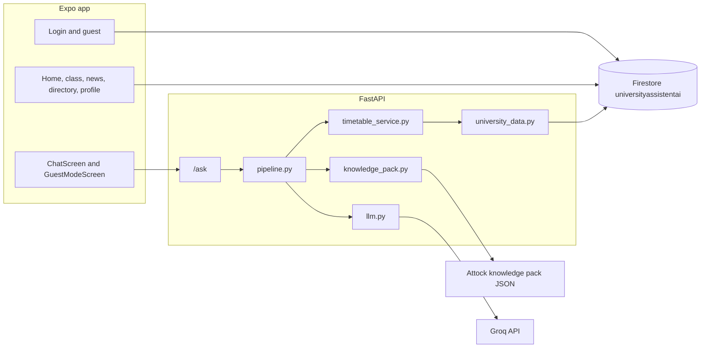
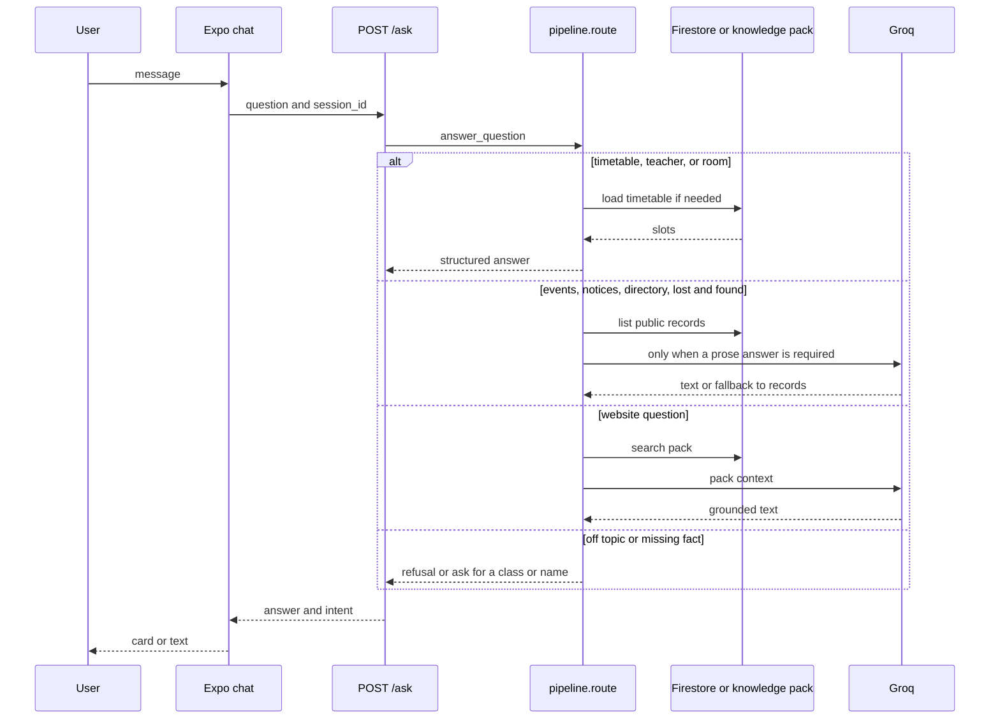
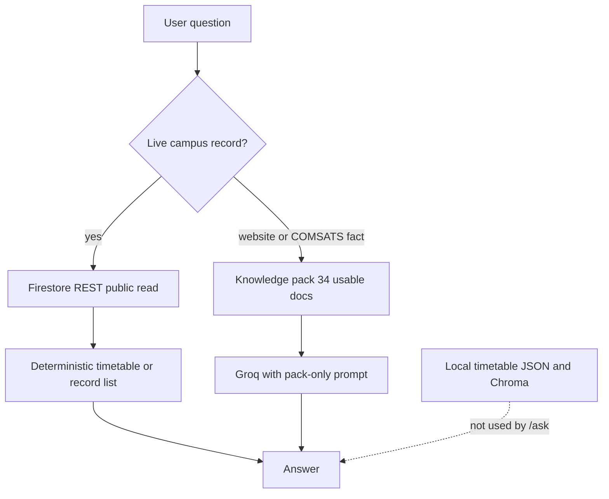

# CampusAI complete system report

This report describes the repository at `E:\Project\Campus_AI-main` as inspected from the current source. It does not change application code. Claims marked **verified** come from the files or from a recorded command in this workspace. Claims marked **not re-verified** were not re-executed for this report.

The running Docker backend was not rebuilt after the latest routing edits in `backend/pipeline.py`, `backend/timetable_service.py`, and `backend/university_data.py`. Those edits are in the working tree. Live answers observed earlier in this session therefore describe the container that was running then, not every line now on disk.

---

## 1. Project overview

CampusAI is a COMSATS University Islamabad, Attock campus assistant. The mobile and web client is an Expo React Native app. Signed-in users get a campus home, class notifications, university news, a teacher directory, a profile, and an AI chat. Guests get a smaller “Website AI” chat and an About page. A separate Vite dashboard reads timetable, teacher, and event data for display.

The chatbot answers timetable, teacher, room, event, announcement, notification, lost-and-found, and COMSATS website questions. Live campus records are read from Cloud Firestore project `universityassistentai`. Website and published campus facts come from the approved Attock Campus Knowledge Pack. Generated prose uses Groq through an OpenAI-compatible client. Timetable, teacher, and room answers are mostly deterministic and do not need the model.

### User types

Defined in `Frontend/src/constants/config.js`:

| Type | How it is chosen | What the app allows |
|---|---|---|
| Student | Self-selected at sign-in. Email must end with `@cuiatk.edu.pk`. | Home, class notifications, uni news, teacher list, profile, AI chat. Can post lost-and-found. Cannot post class notices, events, or timetable uploads. |
| Teacher | Same sign-in, role chosen by the user. | Student areas plus class notifications, events, and timetable upload permission in the client. |
| Staff | Same sign-in, role chosen by the user. | Room reservations, events, lost-and-found moderation, timetable upload permission in the client. |
| Guest | “Continue as Guest”. No Firebase account. | Website AI chat and About Us only. |

Role is stored on the user profile as `type`. It is not a Firebase custom claim. The chatbot `/ask` endpoint does not receive or check the role.

### Technology stack

Versions below are the ranges or images declared in the repo. Python library versions in `backend/requirements.txt` are **unpinned**. Exact installed versions were not re-resolved for this report.

| Layer | Technology | Declared version |
|---|---|---|
| App | Expo | `^57.0.22` (`Frontend/package.json`) |
| App UI | React `19.2.3`, React Native `0.86.3`, React Native Web `^0.21.0` | exact or range as written |
| App storage | `@react-native-async-storage/async-storage` `2.2.0` | exact |
| Navigation packages | React Navigation 6 native, stack, and bottom tabs | installed, **not imported** by app code |
| Backend runtime image | `python:3.11-slim` | `backend/Dockerfile` |
| API | FastAPI, Uvicorn | unpinned |
| LLM client | `langchain-core`, `langchain-openai` | unpinned |
| Fuzzy match | `rapidfuzz` | unpinned |
| Rate limit | `slowapi` | unpinned |
| PDF timetable tools | `pdfplumber`, `pymupdf` | unpinned |
| Optional admin SDK | `firebase-admin` | unpinned; used for upload auth and writes, not for chat reads |
| Vector store library | `chromadb` | present; chat path does not use it |
| Dashboard | React `^18.3.1`, Vite `^5.4.11` | `dashboard/package.json` |
| Containers | Docker Compose | `docker-compose.yml` |
| Data | Firestore REST and, for uploads, Firebase Admin | project `universityassistentai` |

App identity from `Frontend/app.json`: name CampusAI, version `1.0.0`, iOS bundle `edu.cuiatk.campusai`, Android package `edu.cuiatk.campusai`.

---

## 2. Complete project structure

Important top-level areas:

| Path | Role |
|---|---|
| `Frontend/` | Expo app. Entry `App.js`. Source under `Frontend/src/`. |
| `backend/` | FastAPI chatbot, timetable engine, Firestore reader, knowledge pack, PDF upload pipeline, tests. |
| `dashboard/` | Vite admin viewer for timetable, teachers, and events. |
| `firebase/firestore.rules` | Firestore security rules. Not applied by this report. |
| `scripts/migrate_to_firestore.mjs` | One-time migration script. Its dashboard README still points at `backend/timetable_data.json`, which is **not** in the tree now. |
| `docker-compose.yml` | Backend on port 8000. Optional Ollama, Expo, and dashboard profiles. |
| `START_CAMPUS_AI.bat`, `START_CAMPUS_AI.sh` | Launchers that build and run the backend image, then start Expo web. |
| `.agents/skills/` | Expo and EAS skill notes. Not part of the running app. |
| `CAMPUSAI_COMPLETE_SYSTEM_REPORT.md` | This report. |

### Frontend modules

`Frontend/src` has 35 JavaScript modules, plus `Frontend/App.js`.

| Area | Count | Files |
|---|---:|---|
| Screens | 9 | `LoginScreen`, `HomeScreen`, `ClassScreen`, `UniNewsScreen`, `TeacherDirectoryScreen`, `ProfileScreen`, `ChatScreen`, `GuestModeScreen`, `InternalScreen` |
| Hooks | 4 | `useTimetable`, `useScheduleMode`, `useNotifs`, `useEmergencyAnnouncements` |
| Firebase | 3 | `config.js`, `firestore.js`, `teachers.js` |
| Constants | 3 | `config.js`, `colors.js`, `network.js` |
| Utils | 3 | `helpers.js`, `timetableAdmin.js`, `clashingSubjectAliases.js` |
| Components | 13 | UI barrel, map, lost-and-found, events, class posts, timetable admin and editor, search, schedule mode, emergency announcements |

### Backend modules

16 Python modules at `backend/*.py`, plus 9 test modules and `backend/tests/conftest.py`.

| Module | Purpose |
|---|---|
| `API.py` | HTTP API. `/ask`, health, timetable REST, PDF upload, knowledge-pack status. |
| `pipeline.py` | Intent routing, session memory, handlers, Groq prompts for non-deterministic answers. |
| `timetable_service.py` | Class, teacher, room, and day detection. Schedule and availability lookup. |
| `university_data.py` | Read-only Firestore REST client for timetables and campus records. |
| `knowledge_pack.py` | Load and search the Attock knowledge pack. |
| `llm.py` | Select Groq or optional OpenAI and build the chat model. |
| `config.py` | Environment and `backend/.env` loader. |
| `normalizer.py` | Turn student phrases such as `BCS-1` into timetable keys such as `BS(CS)-I`. |
| `comsats_scraper.py` | Keyword classifier `is_comsats_question`. Older scrape and cache helpers remain in the file and are not the live `/ask` path. |
| `timetable_upload.py` | Firebase ID-token check, teacher/staff role check, and Firestore writes for text-PDF timetables. |
| `rule_based_text_pdf.py` | Parse a text PDF into timetable documents. |
| `text_pdf_layout.py` | PDF layout helpers. |
| `teacher_matching.py` | Teacher-name matching used by the PDF pipeline. |
| `pdf_to_json.py` | Older PDF-to-JSON tool. Not the live chat path. |
| `rag_store.py` | Chroma helper. Not imported by `API.py` or `pipeline.py`. |
| `update_comsats_data.py` | Older website update script. Not the live chat path. |

### Knowledge pack

`backend/knowledge_pack/`:

- `attock_campus_knowledge_pack.json` — 35 records, schema `1.0.0`, dataset `comsats_attock_official_seed_2026_10_24`, compiled `2026-10-24`.
- `attock_campus_knowledge_sources.md` — source register.
- `README_Attock_Knowledge_Pack.txt` — usage limits.

The loader skips `website_access_limitation` and category `source_access_note`, so runtime status reports **34** usable documents. That count is asserted by `backend/tests/test_knowledge_pack.py`.

### Tests, config, and deployment

- Tests: `backend/tests/`.
- Backend image: `backend/Dockerfile` (test stage and backend stage).
- Compose: `docker-compose.yml`.
- Env template: `backend/.env.example`. Real values belong only in gitignored `backend/.env`.
- Frontend config: `Frontend/app.json`, `Frontend/package.json`.
- Rules: `firebase/firestore.rules`.

---

## 3. Frontend architecture

Navigation is local React state in `App.js`, not React Navigation. `screen` is `login` or `main`. `activeTab` selects the signed-in tab. Guests are forced to `chat` or `about`.

Signed-in tabs from `NAV_TABS`: AI Chat, Class Notification, Home page, Uni notification, Teacher list, My Profile.

Guest tabs from `GUEST_NAV_TABS`: Website AI, About Us.

### Screens

| Screen | Implemented behavior |
|---|---|
| `LoginScreen` | Email/password and Google sign-in through the Firebase Auth REST API. Role picker: student, teacher, staff. Domain check `@cuiatk.edu.pk`. Guest button. Semester is derived from the email pattern, with a repeater override for students. Teacher sign-in also upserts a teacher directory record. |
| `HomeScreen` | Campus home, room map, timetable views, schedule mode, and staff/teacher timetable tools. Reads Firestore through `useTimetable`. |
| `ClassScreen` | Class notification board. Posting is limited by `can.postClassNotif` to teachers. Exam mode can lock add/cancel; covered by `test_exam_mode_reflection.py` against the source text. |
| `UniNewsScreen` | University events and lost-and-found. Create/edit rights follow `can.postEvent` and lost-and-found permissions. |
| `TeacherDirectoryScreen` | Teacher list from Firestore. |
| `ProfileScreen` | Local profile display and update, including `handleRoleChange` in `App.js`. |
| `ChatScreen` | Signed-in chatbot. Posts to `/ask`. Renders structured schedule, teacher, and room objects as cards. |
| `GuestModeScreen` | Guest chat plus About links to public COMSATS pages. Uses the same `/ask` endpoint. Structured answers are shown as JSON text, not cards. |
| `InternalScreen` | Present in the screen set. Not one of the main tabs. |

### State

There is no Redux or global store. State is React `useState` in `App` and the screens.

Persisted on device with AsyncStorage:

- `campusai_user` — profile JSON, including the self-selected role.
- `campusai_refresh_token` — Firebase refresh token, restored on launch.

Not persisted:

- Chat transcripts. They live in the screen’s `messages` array and disappear on remount or reload.
- Backend session memory. See section 8.

### API communication

`Frontend/src/constants/network.js`:

- AI server: `EXPO_PUBLIC_AI_SERVER_URL`, otherwise `http://<host>:8000`.
- On web, host is the page hostname, so `http://localhost:19006` talks to `http://localhost:8000` unless overridden.
- A second helper, `getTimetableServerUrl`, targets port 3000 via `EXPO_PUBLIC_TIMETABLE_SERVER_URL`. No service in this repo listens on 3000. Timetables in the app come from Firestore, not from that helper.

Chat request, both signed-in and guest:

```json
POST /ask
{ "question": "BCS-1 Monday classes", "session_id": "<random id for this mount>" }
```

The signed-in session id is `(uid or email or "guest")` plus a random suffix. The guest id is `guest-` plus a random suffix. A new page load creates a new id, so follow-up memory does not survive a refresh.

### Incomplete or unused frontend pieces

- React Navigation is a dependency and is unused.
- Guest mode is described in the UI as website-only, but the backend does not enforce that. A guest can ask timetable questions and receive the same `/ask` behavior.
- `handleRoleChange` can change `user.type` in local state. Firestore rules do not independently prove the role.
- Dashboard README and `scripts/migrate_to_firestore.mjs` still describe a local timetable JSON migration. That JSON file is not the chatbot source anymore.

---

## 4. Backend architecture

### Request flow for `/ask`

```text
ChatScreen or GuestModeScreen
  -> POST /ask {question, session_id}
  -> API.ask
       rate limit (default 20/minute)
       optional X-API-Key if CAMPUS_AI_API_KEY is set
       session id falls back to client IP, then "default"
  -> pipeline.answer_question
       get_session(session_id)
       route(question, memory)
       HANDLERS[intent]
  -> {answer, intent}
```

`route` order in `pipeline.py`:

1. Detect class, teacher, and room.
2. Drop a fuzzy teacher match when the name is not actually in the question.
3. If the message is only a day follow-up (“what about Tuesday?”), reuse the last teacher, room, or class.
4. Drop a teacher match when a class is present and the user did not use a teacher cue.
5. If the detected room is the generic name `Lab` or `Labs` and a class is present, clear that room. This does not by itself stop the word “lab” from still matching a room intent when no class is detected.
6. Record intents, in order: emergency/announcement, lost-and-found, event, notification, teacher directory.
7. COMSATS/website question, unless a class or room was detected.
8. Off-topic refusal.
9. Teacher, all-rooms, specific room, unknown room, teacher-without-a-match, timetable.
10. Otherwise general chat.

Handlers:

| Intent | Handler | Model used? |
|---|---|---|
| `timetable` | `handle_timetable` | No. Returns a schedule object or a “name your class” string. |
| `teacher`, `teacher_secondary` | teacher handlers | No. Availability objects or a not-found string. |
| `room`, `rooms_all`, `room_unknown` | room handlers | No. |
| `events`, `lostfound`, `announcements`, `teachers`, `notifications` | `handle_records` | Events with no today/upcoming date return a fixed “in the past” string. Other record answers go to Groq with `RECORD_PROMPT`, then fall back to the formatted records if Groq fails. |
| `comsats_info` | `handle_comsats` | Yes, with `COMSATS_PROMPT` and pack excerpts. Archive hits are prefixed as historical. |
| `off_topic` | fixed refusal | No. |
| `general` | `handle_general` | Greetings and other non-fact chat go to Groq with `SYSTEM_PROMPT`. Questions containing university-fact words are refused without the model. |

Firestore failures raise `UniversityDataUnavailable`. If the question is still a COMSATS question, the pack is tried. Otherwise the error string is returned with intent `unavailable`. There is no silent read of a local timetable JSON.

### How modules call each other

- `API.py` calls `pipeline.answer_question`, `timetable_service` for REST timetable routes, `knowledge_pack.pack_status`, and `timetable_upload` / `rule_based_text_pdf` for PDF upload.
- `pipeline.py` calls `timetable_service`, `university_data.firebase_records`, `knowledge_pack.search_pack`, and `llm.get_chat_model`.
- `timetable_service.ensure_timetable` calls `university_data.load_timetable`.
- `llm.py` reads `config.settings` and constructs `ChatOpenAI`.

PDF upload is a separate path: bearer Firebase token, role check, rule-based parse, write to `text_pdf_timetables`. Chat reads that collection later through REST.

---

## 5. Chatbot intelligence and behavior

### Implemented

- Class phrases such as `BCS-1`, `BSSE-3`, and `cs 1` are normalized to keys like `BS(CS)-I` when that key exists.
- Day words, “today”, and “whole week” select days. The server clock decides “today”.
- Teacher detection uses fuzzy token matching against timetable teacher names, with a check that the name was actually mentioned.
- Room detection normalizes `LT4`, `lecture theater 4`, and similar forms, then fuzzy-matches known rooms.
- Follow-ups such as “what about Tuesday?” reuse the last class, teacher, or room only when the new message has no extra content words. A different session id does not see that memory.
- Unknown class with no detected class returns: mention a class name. The full-sentence fuzzy class match was removed in the working tree so `BS(XX)-IX` is not mapped to a real class. That change is covered by `test_unknown_class_code_is_not_fuzzy_matched` and passed in the last full unit run.
- Unknown teacher and unknown room no longer inherit the previous entity when the question contains a new name or room code. Those unit tests passed in the same run.
- Off-topic keyword “capital of” is classified as `off_topic` in the current source. The unit test `test_capital_of_france_is_off_topic` passed. The **running container** used for the live question sample still treated “what is the capital of France?” as a timetable question, because that process was started before this edit.
- Events are labeled past, today, upcoming, or date-not-published by comparing the record date with the server date. If none are today or upcoming, the handler returns the past records without calling Groq.
- Missing Firestore collections return a clear “no published …” string for empty record lists.
- University-fact words in general chat are refused instead of letting the model invent them.
- Rate limit default is `20/minute` per client address.

### Limits and behavior that is only partly reliable

- The word “what” used to mark almost any question as a timetable question because it was a substring keyword. The current source uses whole-word timetable keywords. That was not redeployed before the live sample, where “what is the capital of France?” and “what is the CWUR 2026 ranking news?” asked for a class name.
- “Is there a lab on Monday for BCS-1?” was answered as the room named `Lab` in the live sample. The later source change still failed `test_lab_meeting_question_is_not_the_room_named_lab`: class detection returned no class for that sentence in the debug check, so the room named Lab remained.
- “Which teacher is free right now?” and all-rooms questions timed out at 90 seconds in the live sample. The working tree caches a successful timetable load for 60 seconds so those scans do not repeat Firestore reads. That cache was not measured on the live server.
- Knowledge-pack retrieval is keyword overlap, not a vector index. A relevant page can be missed, as with the live “CU Online” refusal and the CWUR question being routed away from the pack.
- Groq is instructed not to invent, but record and pack answers that call Groq can still omit or rephrase facts. Deterministic timetable objects are the reliable schedule format.
- Session memory is process-local. A restart, a second worker, or a new browser load drops it.
- There is no planned-feature flag in code. Older scrape, Chroma, and local JSON paths still exist as files but are not the `/ask` data source.

---

## 6. Firebase and data sources

### Project

- Project id: `universityassistentai`.
- Database: `(default)`.
- Client config: `Frontend/src/firebase/config.js`. It contains a Firebase web API key and related client ids. Those values are not copied here.
- Backend chat reads do **not** use a service account. `university_data.py` calls the public Firestore REST API with `User-Agent: campusai-backend/1.0`.
- Writes and upload authorization use `firebase-admin` only when `FIREBASE_SERVICE_ACCOUNT_JSON_BASE64` or `GOOGLE_APPLICATION_CREDENTIALS` is configured. Chat does not need that credential. Whether a service account is present in the local `.env` was not printed and is not reported.

### Rules

`firebase/firestore.rules` (in the repo; deployment state was not checked):

| Path | Read | Write |
|---|---|---|
| `timetable_classes`, `teachers`, `meta`, `timetables`, `text_pdf_timetables`, `settings` | public | signed-in |
| `events`, `lostfound`, `notifications/{dept}/semesters/{sem}/posts`, `emergency_announcements` | public | signed-in |
| `issue_reports` | signed-in | signed-in |
| `users/{userEmail}` | signed-in, and the auth email must equal the document id | same |
| everything else | deny | deny |

Public read is what lets the backend REST client load timetables and campus posts without a user token. `users` and `issue_reports` are not readable that way. The chatbot does not query them.

The rules comment at the top still says events and lost-and-found require sign-in. The match blocks below that comment allow public read. The match blocks are the effective rules text.

### What chat reads

Timetable:

- `settings/schedule_mode` field `mode`: `regular`, `holiday`, or `exam`.
- Manifest `text_pdf_timetables/current`, or `exam_current` when mode is `exam`.
- Class documents listed in `documentIds`. Each document’s `displayRows` JSON is turned into `BS(DEPT)-ROMAN` / day / time slots. Teacher field on a slot is `prof`.
- Holiday mode still loads the regular manifest and the pipeline labels the class as not in session.
- A successful load is reused for 60 seconds in the current source (`_CACHE_TTL_SECONDS`).

Other records, public fields only:

| Kind | Collection | Fields kept |
|---|---|---|
| Events | `events` | title, date, time, endTime, venue, cat, deadline, body |
| Lost and found | `lostfound` | title, type, cat, location, date, resolved, body |
| Announcements | `emergency_announcements` | title, priority, createdAt, body |
| Teacher directory | `teachers` | name, department, office, position, classCount |
| Notifications | `notifications/{dept}/semesters/{n}/posts` | title, subject, type, date, room, lectureNum, body, message, department, semester |

Long strings are truncated at 500 characters. Contact and `postedBy` fields are not in the allow list.

Department codes used for notifications: `ai`, `a_f`, `ba`, `bda`, `ce`, `cs`, `ee`, `english`, `math`, `se`, semesters 1–8.

Empty collections that the code still knows about: `timetable_classes`, `timetables`, `meta`. The live timetable collection used by chat is `text_pdf_timetables`.

### Local files and caches

| Source | Affects `/ask`? |
|---|---|
| Firestore | Yes. Authoritative for live campus records. |
| Knowledge pack JSON | Yes, for website questions only. |
| In-memory timetable cache, 60 seconds | Yes, after a successful Firestore read. Not a separate file. |
| In-memory chat sessions | Yes, for follow-ups in that process. |
| `backend/tests` fixture timetable | Only when pytest’s autouse fixture is active. Not production. |
| `timetable_flat.json`, `comsats_knowledge.json`, `timetable.pdf` | Copied by the Dockerfile. Not read by `answer_question`. |
| `chroma_db` / Chroma | Health reports `rag` as unused. `pipeline.py` does not import `rag_store`. |
| `dashboard/src/data/localSnapshot.json` | Dashboard fallback only. |
| Deleted `timetable_data.json` | Not in the tree. Chat cannot fall back to it. `pdf_to_json.py` can still write that name if someone runs it. |

### Knowledge pack versus Firebase

The pack is a curated seed of public COMSATS pages, compiled 2026-10-24. The pack README says the Attock homepage returned HTTP 403 to the crawler, so it is not a full crawl.

Usable categories include campus overview, contacts, leadership, departments, programs, research, admissions, student resources, university news, accreditation, faculty directory snapshots, and event archives.

Differences:

- Firebase timetable, events, announcements, notifications, lost-and-found, and the `teachers` collection are operational campus data.
- Pack faculty snapshots are marked `PUBLIC WEB SNAPSHOT` and must not be treated as live free/busy schedules.
- Pack event archives are skipped unless the question is about history, archive, or the Silver Jubilee, and answers are prefixed as historical.
- Prospectus figures flagged `official_guide_2025_26` are not live headcounts.
- `website_access_limitation` is not retrieved as a fact.

---

## 7. Groq and model configuration

Verified from `backend/llm.py`, `backend/config.py`, and `backend/.env.example`.

| Item | Value |
|---|---|
| Default provider | Groq, unless `LLM_PROVIDER=openai` |
| Model env | `GROQ_MODEL`, default `openai/gpt-oss-120b` |
| Key env | `GROQ_API_KEY` in `backend/.env` only. Not read from the frontend. |
| Endpoint | `https://api.groq.com/openai/v1` |
| Client | `langchain_openai.ChatOpenAI` |
| Temperature | `0.2` |
| Max tokens | `300` |
| Timeout | `30` seconds on the chat client |
| Fallback model | `get_fallback_chat_model` returns `None` |
| Selection | `get_chat_model`: OpenAI only when `settings.llm_provider == "openai"`. Any other provider, including the Compose default `ollama`, uses Groq. |
| Missing key | `RuntimeError` telling the operator to set `GROQ_API_KEY` |
| Call failure | Record and pack handlers return the retrieved text. General chat returns “The answer model is unavailable right now.” |

A previous health response from the local backend reported provider `groq`, model `openai/gpt-oss-120b`, and that base URL. This report does not repeat any key.

### How to change the model

Set `GROQ_MODEL` in `backend/.env`, or pass it into the container environment, then restart the backend process. Do not put the key in compose files, source, or this report.

Optional OpenAI path: `LLM_PROVIDER=openai`, `OPENAI_API_KEY`, and `OPENAI_MODEL` (default `gpt-4o-mini`). That path has no custom base URL in `llm.py`.

Compose risk: `docker-compose.yml` sets `LLM_PROVIDER` default to `ollama` and does not pass `GROQ_API_KEY` or `GROQ_MODEL` in the `environment` block. The container still receives `backend/.env` through `env_file`. Because the code treats every non-`openai` provider as Groq, an `ollama` label still calls Groq if `GROQ_API_KEY` is in `.env`. The root `START_CAMPUS_AI.bat` path also uses `--env-file backend\.env`.

---

## 8. Identity, roles, and memory

### Authentication

`Frontend/src/firebase/firestore.js` uses the Firebase Identity Toolkit REST API: email/password sign-in, sign-up, Google IdP, and refresh. Tokens stay in module memory and the refresh token is stored in AsyncStorage.

Guest login does not create a Firebase user. `App.js` stores `{ type: 'guest', name: 'Guest' }`.

### Role verification

- The client asks the user to pick student, teacher, or staff and requires `@cuiatk.edu.pk`.
- The profile is saved to `users/{email with dots replaced by underscores}`.
- Rules only check that the signed-in email matches the document id. They do not check that `type` is honest.
- Upload endpoint `POST /upload-timetable` verifies the Firebase ID token with the Admin SDK and requires `users.type` of `teacher` or `staff`, unless `TIMETABLE_UPLOAD_DEV_MODE=true`, which accepts any verified Firebase user and logs a warning.
- `/ask` does not check identity or role. With `CAMPUS_AI_API_KEY` empty, it is open. A health response in this session reported `auth_enabled: false`.

### Profile retrieval

`getUserProfile` / `saveUserProfile` in `firestore.js` read and write that user’s document. Chat does not load the profile to personalize answers. “My schedule today” does not know the signed-in student’s class unless the question text contains it. The chip sends that phrase without a class name.

### Conversation storage

| Store | Lifetime | Contents |
|---|---|---|
| React `messages` | Until the screen unmounts | Visible transcript, including structured cards for signed-in chat |
| `pipeline._SESSIONS` | Until process restart, max 500 sessions, 8 turns (`MEMORY_WINDOW`) | Last class, teacher, room, intent, and a short text window for Groq |
| Firestore | Not used for chat | No conversation collection in the rules |

There is no cross-device chat history.

---

## 9. API and external services

Base URL in local web dev: `http://localhost:8000`.

Auth column: “API key” means the `X-API-Key` header, and only when `CAMPUS_AI_API_KEY` is set. “Firebase bearer” means `Authorization: Bearer <Firebase ID token>`.

| Method | Path | Auth | Body / params | Response |
|---|---|---|---|---|
| GET | `/health` | none | — | `status`, `llm` provider/model/base URL, unused `rag`, `knowledge_pack`, `auth_enabled`, `rate_limit` |
| POST | `/ask` | API key, rate limit | `{ "question": string, "session_id"?: string }` | `{ "answer": string or object, "intent": string }` |
| POST | `/student-timetable` | API key | `{ "class_name": "CS-I" }` | `{ success, data: { class, schedule_by_day } }` or `{ success: false, error }` |
| GET | `/today-classes/{class_name}` | API key | path | `{ success, class, day, classes }` |
| GET | `/class-schedule/{class_name}/{day}` | API key | path | `{ success, class, day, classes }` |
| GET | `/comsats/status` | none | — | Pack path, compiled date, document count. Does not scrape. |
| GET | `/comsats/refresh` | API key, 2/minute | optional `max_pages` ignored | Reports the pack. Does not scrape or write Chroma. |
| POST | `/upload-timetable` | Firebase bearer, 2/minute | multipart PDF plus `version`, `effectiveDate`, `scheduleMode` | Saved document ids, or 422 for a non-text PDF or validation error |

Example `/ask` response shapes:

```json
{ "answer": "Hello. I can help with schedules and COMSATS questions.", "intent": "general" }
```

```json
{
  "answer": {
    "type": "schedule",
    "class": "BS(CS)-I",
    "day": "Monday",
    "classes": [
      {"subject": "Example", "teacher": "Example Teacher", "room": "LT1", "time": "10:00-11:30", "day": "Monday"}
    ]
  },
  "intent": "timetable"
}
```

Other structured `answer.type` values the signed-in UI understands include `teacher_availability`, `room_availability`, `teacher_classes`, `class_rooms`, `class_teachers`, `subject_teachers`, `rooms_free`, `rooms_schedule`, `next_class`, and `teachers_free_now`. Unknown object shapes fall through a generic card renderer.

### External services

| Service | Use |
|---|---|
| Groq `https://api.groq.com/openai/v1` | Generated answers |
| Firestore REST `https://firestore.googleapis.com/v1/projects/universityassistentai/...` | Chat reads |
| Firebase Auth REST | App sign-in |
| Firebase Admin | Upload token check and timetable writes, when credentials exist |
| Public COMSATS URLs | Linked from the guest About page. Not fetched by `/ask`. |
| Optional OpenAI | Only if `LLM_PROVIDER=openai` |
| Optional Ollama container | Compose profile `ollama`. Not selected by `llm.py` unless the provider string is changed in code. The current code does not call Ollama. |

---

## 10. Running and deployment

### Required software

- Docker, for the supported backend image (`python:3.11`).
- Node.js and npm, for Expo and the dashboard.
- A `backend/.env` based on `.env.example`, including `GROQ_API_KEY`, if generated answers are required. Deterministic timetable routes still need network access to Firestore.

Do not commit `.env`.

### Ports

| Port | Process |
|---|---|
| 8000 | FastAPI |
| 19006 | Expo web (`expo start --web --port 19006`, also mapped by the Compose frontend profile) |
| 8081 | Metro, mapped by the Compose frontend profile |
| 5173 | Dashboard container maps host 5173 to container port 80. `npm run dev` in `dashboard/` serves Vite’s own dev port; the README says `http://localhost:5173`. |
| 11434 | Optional Ollama profile |

### Commands that match the repo

Backend image and API:

```bat
docker build -t campusai-backend backend
docker run --rm -d --name campusai-backend --env-file backend\.env -p 8000:8000 campusai-backend
```

`START_CAMPUS_AI.bat` builds `campusai-backend`, runs it as `campusai-backend-launcher` with `--env-file backend\.env` and a volume `backend\ocr_data:/data`, then starts Expo web from `Frontend` and opens `http://localhost:19006`.

Compose:

```bat
docker compose up --build
```

That starts only the backend service. Frontend and dashboard need their profiles:

```bat
docker compose --profile frontend up --build
docker compose --profile dashboard up --build
```

Frontend without Docker, from `Frontend/`:

```bat
npm install
npx expo start --web --port 19006
```

The web app then calls `http://localhost:8000` unless `EXPO_PUBLIC_AI_SERVER_URL` is set.

Unit tests, as run in this workspace, use the Docker test stage so imports match the image:

```bat
docker run --rm -v E:\Project\Campus_AI-main:/workspace campusai-backend-test
```

The test image command is `python -m pytest -q /workspace/backend/tests` with `PYTHONPATH=/workspace`.

### Frontend to backend

Browser on `http://localhost:19006` uses `getAiServerUrl()` → `http://localhost:8000`. Firestore reads from the app go directly to Google, not through FastAPI. Chat does not attach the Firebase token.

---

## 11. Tests and known issues

### Automated tests

Location: `backend/tests/`. They use an in-memory timetable fixture from `conftest.py` so they do not call Firestore or Groq, except `test_firebase_failure_does_not_read_local_json`, which forces a network failure.

| File | Covers |
|---|---|
| `test_routing.py` | Intent routing, class/teacher/room detection, follow-ups, unknown entity, off-topic, lab-versus-room |
| `test_chat_behavior.py` | Schedule shape, session isolation, punctuation, blank input, off-topic without a model |
| `test_ask_api.py` | `/health`, `/ask` shape, validation, optional API key |
| `test_university_data.py` | Display-row mapping, no local JSON fallback, record routing, no Chroma import in the chat modules |
| `test_knowledge_pack.py` | 34 usable docs, limitation note skipped, campus list, archive filter, website routing |
| `test_rule_based_text_pdf.py` | PDF cell patterns and validation |
| `test_text_pdf_persistence.py` | Manifest writes |
| `test_exam_mode_reflection.py` | Exam versus regular ids and frontend source checks |
| `test_ocr_split_cells.py` | Split-cell timetable rows |

### Latest verifiable results

These are the runs recorded in this workspace. They were not repeated for this report.

| Run | Result |
|---|---|
| Backend suite before the latest routing edits | **74 passed, 2 warnings** in about 6.6s. Warnings are FastAPI `@app.on_event("startup")` deprecation in `API.py`. |
| Suite after routing tests were added and before the lab test failed | **78 passed, 2 warnings**. |
| Latest full suite | **1 failed, 78 passed, 2 warnings** in 7.62s. Failure: `test_routing.py::test_lab_meeting_question_is_not_the_room_named_lab`. |
| Pytest cache `backend/tests/.pytest_cache/v/cache/lastfailed` | Lists that same test as last failed. |

### Live question sample

A script posted **83** questions to `http://127.0.0.1:8000/ask` and saved results outside the repo. **19** further scripted questions were not sent. The script’s checker required every expected phrase, so its **58 OK / 25 FAIL** split is not a pure quality score.

Confirmed from saved answers against the container that was running then:

- `BS(XX)-IX` was answered as `BS(AI)-I`. The current source test expects this not to happen. That fix was not on the running container.
- `room ZZZ-999` was answered as `LT8`, and `Sir Zzzzzz` was answered as Muhammad Fawad, in a shared session. Current unit tests cover the corrected follow-up rule.
- “What is the capital of France?” asked for a class name.
- “Is there a lab on Monday for BCS-1?” returned the room named Lab.
- “Which teacher is free right now?”, “which rooms are free on Friday morning?”, and “show all rooms availability” timed out at 90 seconds.
- “Tell me about CU Online” was refused as off-topic.
- “What is the CWUR 2026 ranking news?” asked for a class name.
- Department answer named Mathematics and Computer Engineering and did not mention Management, which is a pack document id `management_sciences_department`.
- `BS(AI)-I` Thursday included Pre Calculus I, Muhammad Sulaiman, LT1, 08:30–10:00. A direct Firestore read of `text_pdf_timetables/ai_sem1` showed that same Thursday slot.
- Event checks that the script marked OK contained its required “past” and “no upcoming” phrases. Full text of those OK answers was not stored in the terminal log.
- Rector, prospectus student count, lost-and-found, BCS-1 notifications, and the Lab CS3 emergency text were present in answers the script marked FAIL only because a required word was missing.
- No browser chat turns were executed in that sample. Expo was only confirmed to respond on port 19006.

### Other risks

- `/ask` is unauthenticated when `CAMPUS_AI_API_KEY` is empty.
- Firestore campus collections are world-readable in the rules file.
- Users choose their own role. Only timetable upload checks the saved role, and the dev-mode switch bypasses it.
- Compose advertises Ollama while the code calls Groq.
- Requirements are unpinned, so image rebuilds can change library versions.
- All-rooms and all-teachers scans are expensive if the timetable cache misses, because each lookup re-reads Firestore.
- Guest UI and signed-in UI share one unrestricted chat API.
- Stale docs (`dashboard/README.md`, Compose comments, `comsats_scraper.py`) describe JSON, Chroma, or live scraping that `/ask` does not use.
- `issue_reports` and per-user profiles were not read for this report. Their contents are unknown here.
- Whether `exam_current` exists in production was not re-queried for this report. Earlier inspection in this project found it missing while `settings/schedule_mode` was `regular`. That live fact was not rechecked now.

---

## 12. Architecture diagrams

### Application



### Chat request



### Data sources



### Identity and memory

```mermaid
flowchart TB
  Sign[Email, Google, or Guest]
  Sign --> Profile[AsyncStorage profile and optional Firebase user]
  Profile --> Role[Self-selected student, teacher, staff, or guest]
  Role --> UI[Which tabs render]
  Role -.->|not sent| Ask[/ask]
  UI --> ChatState[React messages, lost on reload]
  Ask --> Mem[Process session: last class, teacher, room, 8 turns]
  Upload[Timetable PDF upload] --> Token[Firebase ID token]
  Token --> Check[users.type must be teacher or staff]
```

---

## 13. Final status and recommendations

### What works in the current source

- Signed-in and guest UIs, Firebase email/Google sign-in, and direct Firestore screens for timetable, notifications, events, announcements, and teachers.
- `/ask` contract `{answer, intent}` with a session id.
- Deterministic timetable, teacher, and room answers when detection succeeds.
- Firestore as the live timetable source, with a hard error if the read fails.
- Knowledge pack as the website source, with archive and prospectus flags.
- Groq for prose, with the model and endpoint configured as above.
- Unit coverage for routing, pack search, API shape, and PDF timetable conversion. The last full run was 78 passed and 1 failed.

### Partial

- Roles exist in the client and on the user document, but chat ignores them and rules do not prove them.
- Guest “website only” is a UI limit, not an API limit.
- Chat history is on-screen only. Follow-up memory is in the backend process only.
- Website retrieval is keyword search. Some pack documents are missed.
- Event dating is implemented. Groq record answers can still paraphrase.
- The 60-second timetable cache and the stricter router are in source and were unit-tested except for the failing lab case. They were not redeployed for the live sample.

### Broken or unverified

- Lab-meeting questions still route to the room named Lab. The unit test fails.
- The live container used for the 83-question sample still had the older router: unknown class fuzzy match, follow-up stealing a previous teacher or room, and “what …” treated as a timetable question.
- All-rooms and “who is free now” timed out in that sample.
- Browser end-to-end chat was not executed for this report.
- Production deployment of `firestore.rules`, presence of a service account, and current `exam_current` were not rechecked.
- Python dependency versions are unpinned and were not frozen.

### Security and performance

- Open `/ask` and public Firestore reads expose campus operational posts to anyone who can reach the API or Google’s REST endpoint.
- Self-selected roles plus `TIMETABLE_UPLOAD_DEV_MODE` are privilege risks if that flag is left on.
- Do not log or commit `GROQ_API_KEY`, Firebase admin JSON, or refresh tokens.
- Repeated Firestore document downloads make wide teacher and room questions slow when the cache is cold. Groq calls add roughly the model latency on top, with a 30-second client timeout.
- Rate limit is 20 requests per minute per IP, which is easy to hit during a test sweep.

### Phased improvements

These are recommendations only. They were not started.

1. Rebuild and restart the backend from the current source, then retest the failed live cases: unknown class, unknown room, unknown teacher, capital-of-France, lab-for-a-class, free-now, and all rooms. Fix the lab test before treating that route as done.
2. Keep `/ask` fail-closed. Add a short cache around manifest reads only, and make all-room and all-teacher scans use the in-memory index once per request.
3. Point keyword misses such as CU Online, CWUR, and Management Sciences at the pack before the off-topic or timetable fallback.
4. Send no secrets to the client. If `/ask` must be locked, set `CAMPUS_AI_API_KEY` and pass it only from a trusted host, or require a Firebase token.
5. Stop trusting self-selected roles for uploads. Use verified claims or a staff allow-list, and keep `TIMETABLE_UPLOAD_DEV_MODE` off outside local development.
6. Persist chat only if a product decision requires it. Until then, document that history is per page load.
7. Align Compose, the dashboard README, and the scraper module with the real Groq-and-Firestore design so the next operator does not turn Ollama, Chroma, or a deleted JSON file back on.
8. Pin backend dependencies and re-run the Docker pytest suite after each routing change.

---

## Inspection limits

- No application source, Firebase data, or rules were modified to produce this report.
- API keys and user records were not printed.
- The 100–200 question browser plan was not restarted.
- Library versions inside the image were not queried.
- The report’s live-answer section uses the saved 83-question run and one Firestore document read from earlier in the same workspace session. Those were not repeated.
