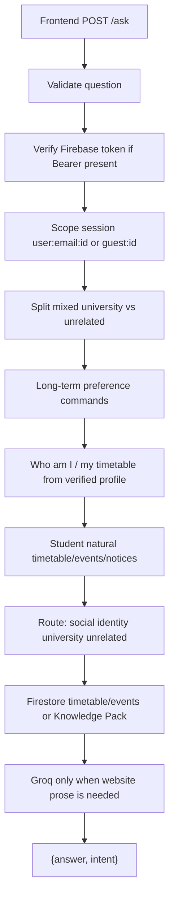

# CampusAI final engine implementation report

Last reviewed: 2026-10-30. Git checkpoint: `7346f64` on `setup/chatbot-test-env`. No remote push, deploy, Firestore write, rule change, or secret dump was performed.

## 1. Executive summary

The existing FastAPI chatbot remains the foundation. Live `/ask` still returns `{answer, intent}`. Groq remains `openai/gpt-oss-120b`. Structured campus records still come from Firestore. Approved website text still comes from the Attock Knowledge Pack. ChromaDB/`rag_store.py` is still not on the live `/ask` path.

This pass repaired source conflicts that blocked the master-prompt behaviour:

- “Who are you?” is a CampusAI introduction. “Who am I?” remains the verified profile.
- Friendly greetings such as “How are you, my friend?” stay social and do not load the timetable or Groq.
- Unrelated questions are refused politely and no longer mention the Knowledge Pack.
- Off-topic words such as `cat` no longer match inside `notifications`. Pack relevance now also needs a campus anchor, so “dog vs cat” is not treated as a website question.
- Short-term memory keeps eight message pairs plus a compact summary of dropped turns, still namespaced by verified email or guest.
- Optional in-process long-term preferences exist for signed-in users only, with view/delete and a secret filter. They do not override profile, timetable, or documents, and they are lost when the process restarts.
- Student overlap questions compare published meetings and do not claim authority to change the timetable.
- Document retrieval for website questions is `knowledge_pack.retrieve_campus_documents` → Groq. A unit test proves the retrieved records reach the model prompt.

**Final `/ask` flow**

## 2. Original architecture and baseline

Before this pass:

- `API.ask` verified tokens, namespaced sessions, called `pipeline.answer_question`.
- Social replies existed for exact phrases only. Extra words such as “my friend” missed the greeting set.
- Bot identity was not distinct from student “who am I”.
- Unrelated refusals used a long timetable-assistant template.
- Missing pack hits said “the approved knowledge pack does not include that information”.
- `pack_is_relevant` could score incidental words and steal dog/cat questions.
- Chroma RAG was unused. Knowledge pack retrieval did reach Groq for COMSATS questions.
- Teacher/staff personal schedules used profile name matching; staff had no class timetable.
- Session memory was in-process with a sliding window and entity fields. No rolling summary. No long-term store.

Baseline tests before the new engine tests: 127 backend tests in the earlier Stage 11 image. After this pass: **136 passed, 2 warnings**. Frontend history: **6 passed**.

## 3. Backend file inventory

See `docs/CAMPUSAI_ENGINE/05_BACKEND_FILE_INVENTORY.md` for the full table. Active `/ask` modules: `API.py`, `pipeline.py`, `identity.py`, `university_data.py`, `timetable_service.py`, `knowledge_pack.py`, `normalizer.py`, `llm.py`, `config.py`, `comsats_scraper.py` (`is_comsats_question` only). `rag_store.py` exists and is unused by `/ask`. PDF upload modules are active for `/upload-timetable` only.

## 4. Confirmed conflicts

| Source | Defect | Correction | Dependents | Regression |
| --- | --- | --- | --- | --- |
| `pipeline._has_unrelated_keyword` | `cat` matched inside `notifications` | Whole-word regex | mixed notices | `test_identity.py` notices-and |
| `pipeline.handle_general` / `_SMALLTALK` | “How are you, my friend?” not social | `_is_social` | route, general | `test_engine_policy.py` |
| `pipeline.personal_reply` vs identity | “Who are you?” had no bot intro | `_is_bot_identity` + `INTRO` | route, general | `test_engine_policy.py` |
| `pipeline.REFUSAL` / `handle_comsats` | Internal pack name in user text | Polite university-only wording | off_topic, comsats | `test_engine_policy.py` |
| `pipeline._clearly_unrelated` | Pack score stole dog/cat | Require campus/pack anchor | route | `test_engine_policy.py` |
| `pipeline.SessionMemory` | Dropped turns vanished | Compact `summary` | follow-ups | `test_engine_policy.py` |
| None | No long-term preference store | In-process `_LONG_TERM` | answer_question | `test_engine_policy.py` |
| None | Clash questions not compared | `_student_timetable_overlaps` | student natural | `test_engine_policy.py` |

## 5. Stages completed (2026-10-30)

1. Inventory, request-path trace, baseline tests.
2. Source fixes above.
3. Token/profile isolation already present; tests retained. No production rule changes.
4. Social / identity / university / unrelated / mixed routing.
5. Prompt cleanup; Groq still factual temperature 0.2, max tokens 300, timeout 30.
6. Window of 8 pairs + summary; session still `user:{email}:{id}` or `guest:{id}`.
7. Optional signed-in preferences; Guest cannot save; restart wipes process memory.
8. Proven pack retrieval path; Chroma unused.
9. Firestore timetable/events/notices unchanged; overlap comparison added.
10. Greetings/identity/refusals still skip Groq and timetable. No production bind/CORS change.
11. 136 backend tests, 6 history tests. Live Student/Teacher/Staff browser not re-run in this pass.
12. This report plus `docs/CAMPUSAI_ENGINE/`.

## 6. Files changed

Changed: `backend/pipeline.py`, `backend/knowledge_pack.py`, `backend/API.py`, `backend/tests/test_engine_policy.py`.

Created: `CAMPUSAI_FINAL_ENGINE_IMPLEMENTATION_REPORT.md`, `docs/CAMPUSAI_ENGINE/**`.

Unchanged on purpose: Firestore rules, Knowledge Pack JSON, Groq provider, `/ask` JSON contract, frontend screens except prior Expo Go work already committed.

## 7. Routing policy examples

| Input | Category | Result |
| --- | --- | --- |
| Hi / How are you, my friend? / Thank you! | social | Short greeting or thanks. No Groq. |
| Who are you? / What can you help me with? | identity | CampusAI intro. |
| Who am I? (student token) | university/profile | Verified name, department, semester, class. |
| Dog vs cat / capital of France | unrelated | `REFUSAL`. |
| BCS-1 Monday and capital of France | mixed | Monday schedule + university-part note. |
| What about Tuesday? | follow-up | Same class/day if this session has a class. |
| Two classes at the same time (student) | university problem | Published overlaps, no change claimed. |

## 8. Guardrails

- Role comes from verified token + profile document, not JSON `role`.
- Guest sessions cannot reuse `user:` memory keys.
- Retrieved pack text is evidence; injection text is not executed as policy.
- Rate limit remains 20/minute. Open API when `CAMPUS_AI_API_KEY` is empty (dev).

## 9. Memory

Short-term: process dict `_SESSIONS`, 8 pairs, summary of dropped human turns, entity fields. New chat id → new session. Frontend AsyncStorage is separate.

Long-term: process dict keyed by verified email. Save/view/forget phrases only. Max 10 notes. No passwords/tokens. **Not durable across restart. Not in Firestore.** Status: `Partially implemented` (verified in unit tests only).

## 10. Document retrieval (RAG)

Live path: `retrieve_campus_documents` = `search_pack` on `attock_campus_knowledge_pack.json`. Proven by `test_document_retrieval_reaches_the_model_prompt`. Chroma/`rag_store.py`: `Not implemented` on `/ask`. Greetings, identity, unrelated do not search the pack.

## 11. Firestore

Active timetable: `university_data.load_firebase_timetable` reads `text_pdf_timetables` current/exam manifests. Local `timetable_flat.json` is not an `/ask` fallback. Caches 300s.

## 12. Groq

Provider groq, model `openai/gpt-oss-120b`, temperature 0.2, max tokens 300, timeout 30. No secret values recorded. `get_fallback_chat_model` returns None.

## 13. Tests vs baseline

| Check | Baseline | Final |
| --- | --- | --- |
| Backend pytest | 127 passed (Stage 11 image) | **136 passed, 2 warnings, 7.37s** |
| Frontend history | 6 passed | **6 passed** |
| Lint/type | none configured | Not tested |

## 14. Per-mode table

| Mode | Social/identity/unrelated | University | Live browser this pass |
| --- | --- | --- | --- |
| Guest | Passed (unit) | Public class timetable Passed (unit) | Not tested |
| Student | Passed (unit, fixtures) | Profile, next class, overlap Passed (unit) | Not tested (earlier Stage 11 browser was a prior session) |
| Teacher | Unrelated Passed (unit) | Name-matched timetable Passed (unit) | Not tested |
| Staff | Unrelated Passed (unit) | No personal class timetable Passed (unit) | Not tested |

## 15. Performance

Existing measurements still hold: greetings ~0s without Groq; first identity/profile ~3s when token+Firestore are cold; timetable after prefetch under ~0.01–0.6s; unrelated refusal under 0.01s. This pass did not invent new live timings.

## 16. Remaining blockers

- Long-term memory is not persisted.
- Chroma RAG is unused; product decision needed before activating it.
- Teacher/Staff live accounts were not signed in during this pass.
- FastAPI `on_event` deprecation warnings remain.
- Open API and CORS `*` in local dev remain.
- Windows firewall may still block phone access to port 8000.

## 17. Security

No production data/rules changed. No push/deploy. `.env` remains untracked. Tokens are not logged.

## 18. Rollback

`git checkout 7346f64` restores the pre-engine-pass tree. This work is uncommitted until you choose to commit locally. Do not push unless you add a remote.

## 19. Documentation package

Folder: `docs/CAMPUSAI_ENGINE/`. Index: `docs/CAMPUSAI_ENGINE/README.md`.
