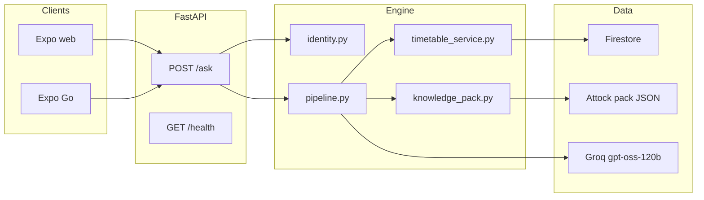

# Architecture

## Layers

1. HTTP validation, rate limit, optional API key — `API.py`
2. Token verify and profile read — `identity.py`
3. Session scope — `API.chat_session_id` + `pipeline.get_session`
4. Policy and route — `pipeline.route`
5. Structured queries — `university_data` / `timetable_service`
6. Unstructured website records — `knowledge_pack.retrieve_campus_documents`
7. Prose — Groq only when a pack answer needs wording

Chroma (`rag_store.py`) is **not** connected to `/ask`.
