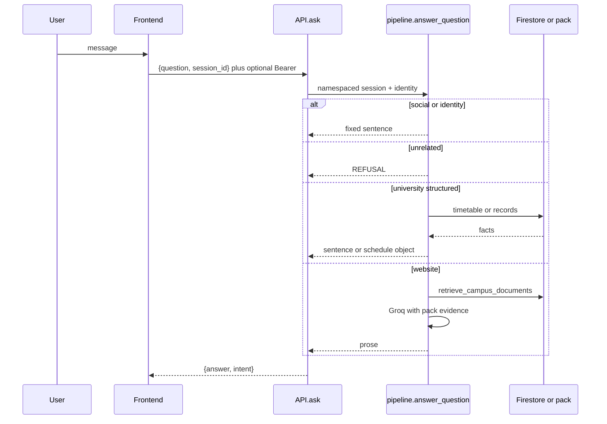

# End-to-end workflow

| Kind | Path |
| --- | --- |
| Social | `_is_social` → `handle_general` |
| Identity (bot) | `_is_bot_identity` → `INTRO` |
| Identity (user) | `personal_reply` / `_asks_role` |
| Unrelated | `_clearly_unrelated` → `off_topic` |
| Mixed | `_university_portion` then note |
| Follow-up Tuesday | entity memory `last_class` |
| Website | `comsats_info` → pack → Groq |
