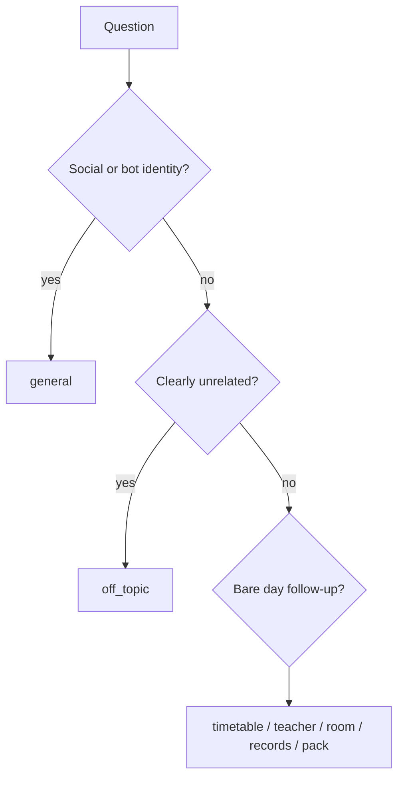

# Normalization and routing

There is no `normalization.py`. Class tokens use `normalizer.normalize_to_key` (`BCS-1` → `BS(CS)-I`).

Router: `pipeline.route`.

False-positive guards: whole-word keywords; `_has_pack_anchor`; lab-for-class vs room named Lab; teacher fuzzy match must mention the name.
